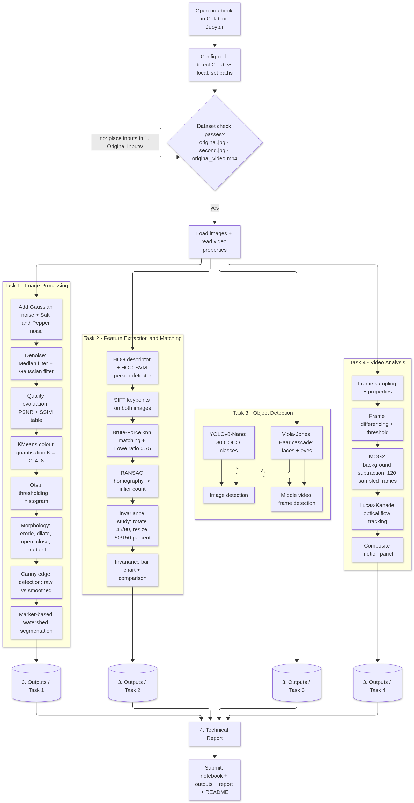

# Computer Vision CCA 3 — Technical Report

**Practical Coding Assignment — Units 3, 4 and 5**

**Name: Rushit Patel | Student ID: 1272251039**

Notebook: `2. Source Code/Computer_Vision_CCA3_1272251039.ipynb`
Environment: Python 3 · Google Colab / Jupyter · NumPy · Matplotlib · OpenCV · scikit-image · scikit-learn · Ultralytics YOLOv8

---

## 1. Objectives

1. Implement and evaluate fundamental image processing pipelines (noise, restoration, segmentation).
2. Extract image features and quantify matching robustness with HOG and SIFT.
3. Detect faces and generic objects with classical and deep-learning methods.
4. Analyse video with frame differencing, background subtraction and optical-flow tracking.

All experiments are reproducible: the notebook is seeded (`random`/`numpy` seed 1272251039) and every figure is auto-saved to `3. Outputs/Task N/`.

---

## 2. Tools and Setup

| Component | Choice |
|---|---|
| Language | Python 3 (Colab / Jupyter) |
| Image & video I/O, transforms | OpenCV (`opencv-python`, pinned `<5` to match Colab's 4.x) |
| Numeric / plotting | NumPy, Matplotlib |
| Metrics / descriptors | scikit-image (SSIM, HOG), scikit-learn (KMeans) |
| Deep detector | Ultralytics YOLOv8-Nano (`yolov8n.pt`, COCO pre-trained, auto-download) |
| Input data | `1. Original Inputs/` — `original.jpg` (street + portrait composite from Wikimedia Commons), `second.jpg` (transformed variant), `original_video.mp4` (7 s synthetic moving-object scene) |

A single configuration cell in the notebook auto-detects Colab vs. local execution and defines all paths, so the same notebook runs unchanged in both environments (`Runtime → Run all` in Colab; `jupyter` locally after `pip install -r requirements.txt`).

---

## 3. Task 1 — Image Processing

### Methodology

1. **Noise synthesis** on `original.jpg`:
   - *Gaussian noise*: per-pixel additive noise `N(0, σ=20)` — models uniform sensor/low-light noise.
   - *Salt-and-pepper*: 5 % of pixels forced to pure black or white — models impulse/data-dropout noise.
2. **Restoration** — the same two linear/non-linear filters applied to *both* degraded versions:
   - *Median filter* (5×5): replaces each pixel with the neighbourhood median; impulse outliers can never become the median, so they are eliminated.
   - *Gaussian filter* (5×5 σ=0): weighted local averaging; suppresses Gaussian noise but blurs edges.
3. **Quantitative evaluation** against the clean original:
   - `PSNR(dB) = 10·log10(255² / MSE)`
   - `SSIM` (scikit-image, luminance-contrast-structure similarity, `data_range=255`)
   - Table spans all degradation/restoration combinations, so the best filter *per noise type* is visible at a glance.
4. **KMeans colour quantisation** (scikit-learn): pixels clustered into K ∈ {2, 4, 8} dominant colours in RGB space — segmentation-like posterisation and the assignment's scikit-learn usage.
5. **Otsu thresholding** — automatic two-class threshold minimising intra-class variance; visualised together with the grayscale histogram (threshold marked in red).
6. **Morphology** — erosion, dilation, opening, closing and gradient on the Otsu mask with a 5×5 structuring element.
7. **Canny edges** — compared on raw vs. Gaussian pre-blurred grayscale to show smoothing suppressing noise-induced edges.
8. **Marker-based watershed** — Otsu foreground → morphological opening → sure-background (dilation) → sure-foreground (distance-transform peaks) → `connectedComponents` seeds → watershed; boundaries (label −1) overdrawn in red.

### Results and Observations

- PSNR/SSIM quantify expectations: each denoised image scores above its noisy source, and **median filtering is decisively better for salt & pepper**, while the **Gaussian filter is the better (though imperfect) choice for additive Gaussian noise**.
- KMeans K=8 retains the closest resemblance to the original; K=2 yields a clean abstract two-tone segmentation.
- The Otsu threshold lands in the deepest histogram valley; morphological opening reliably removes speckle from the binary mask, which makes the watershed seeding robust.

---

## 4. Task 2 — Feature Extraction and Matching

### Methodology

1. **HOG** (`skimage.feature.hog`, 9 orientations, 8×8 cells, 2×2 blocks, L2-Hys): returns the normalised feature vector and a gradient-orientation visualisation. OpenCV's built-in HOG + linear-SVM person detector is additionally demonstrated.
2. **SIFT** (`cv2.SIFT_create`): keypoints on both images drawn with rich (size + orientation) rendering.
3. **Brute-Force matching**: `BFMatcher` with `knnMatch(k=2)` over L2 distance; **Lowe ratio test** (0.75) rejects ambiguous nearest neighbours; **RANSAC homography** counts geometrically consistent inliers.
4. **Invariance study**: the original is matched against itself transformed four ways — 45°/90° rotations (canvas-expanding warp) and 50 %/150 % resizes. Good-match and inlier counts are charted.

### Results and Observations

- SIFT + ratio-test matching recovers a high fraction of true correspondences; RANSAC inliers are the strongest reliability indicator because a single global homography must explain them.
- **Rotation invariance derives from the descriptor being computed in each keypoint's dominant-orientation frame**; matches decay gracefully with angle.
- **50 % downscale** reduces the absolute keypoint count (fewer pixels and coarser blur levels) but surviving matches remain geometrically consistent; **150 % upscale** multiplies keypoints, many of them at artefact-dominated scales.
- HOG and SIFT differ fundamentally: HOG is a *dense, global* appearance descriptor for classification windows, SIFT a *sparse, local, invariant* descriptor for matching/geometry — hence the complementary roles observed here.

---

## 5. Task 3 — Object Detection

### Methodology

1. **Viola–Jones** (`haarcascade_frontalface_default.xml`): integral-image Haar features + AdaBoost cascade; `detectMultiScale(scaleFactor=1.1, minNeighbors=5)`; eyes detected within each face ROI (`haarcascade_eye.xml`).
2. **YOLOv8-Nano** (`yolov8n.pt`): single-stage CNN detector; `conf=0.40`; results parsed per object (class, confidence, box) and visualised via the built-in `plot()`.
3. Both detectors run on `original.jpg` **and** on the middle frame of `original_video.mp4`.

### Results and Observations

- Viola–Jones is nearly instant and precision-oriented for *frontal* faces, but fails under profile pose, occlusion or poor lighting, and recognises nothing beyond faces/eyes.
- YOLOv8-Nano, pre-trained on 80 COCO classes, supplies far richer detections with confidences and is robust to pose/illumination, at the cost of a model download and more compute (still real-time capable).
- The contrast — narrow, hand-crafted fast detector vs. broad, learned multi-class detector — is the key methodological takeaway of the task.

---

## 6. Task 4 — Video Analysis

### Methodology

1. **Frame extraction**: video properties (fps, frame count, size) via `VideoCapture`; five sampled frames across the timeline saved and displayed.
2. **Frame differencing**: `absdiff` between two frames two percent of the timeline apart → threshold at 30 → morphological opening; motion percentage reported.
3. **MOG2 background subtraction** (`history=500, varThreshold=40, detectShadows=True`): a Gaussian-mixture model per pixel absorbs a sampled pass (≤120 frames); masks captured at 25 %/50 %/75 % of the timeline show model maturity; the best mask is cleaned and colour-overlaid on its frame.
4. **Lucas–Kanade optical flow**: Shi-Tomasi corners (`goodFeaturesToTrack`, 150 points) tracked with `calcOpticalFlowPyrLK` (`winSize=21×21`, 3 pyramid levels) across up to 60 frames; surviving points are reseeded each frame and colour-coded trails accumulate on an overlay, finally alpha-blended onto the first frame.

### Results and Observations

- Frame differencing is the cheapest motion signal but cannot adapt to illumination change and treats the whole changed region as foreground.
- MOG2 produces a well-defined, model-backed foreground (with grey-coded shadow) that improves as history accumulates — the preferred tool on stationary-camera footage.
- LK yields sparse but stable long-range tracks: moving-object points trace visible colour trails while static-background points remain fixed; occasional points drop out when they leave the frame or lose corner structure.

---

## 7. Conclusions

- Classical filtering, thresholding, morphology, HOG/SIFT features, cascaded and deep detection, and motion analysis were each implemented, visualised and *quantified* (PSNR/SSIM tables, match/inlier counts, motion percentages).
- Filter choice is noise-type dependent; RANSAC-filtered keypoint matching is a reliable geometric matcher under rigid transforms; classical vs. deep detection trades generality against speed; adaptive background modelling outperforms naive differencing for sustained video motion.
- The full pipeline is reproducible end-to-end from `README.md` → `requirements.txt` → notebook → `3. Outputs/`.

---

## 8. How to Reproduce

1. `pip install -r requirements.txt` (or the pip cell in the notebook for Colab).
2. Place `original.jpg`, `second.jpg`, `original_video.mp4` in `1. Original Inputs/`.
3. Run **all** cells of `2. Source Code/Computer_Vision_CCA3_1272251039.ipynb` top-to-bottom.
4. Compare figures with the pre-generated results in `3. Outputs/Task 1–4/`.
