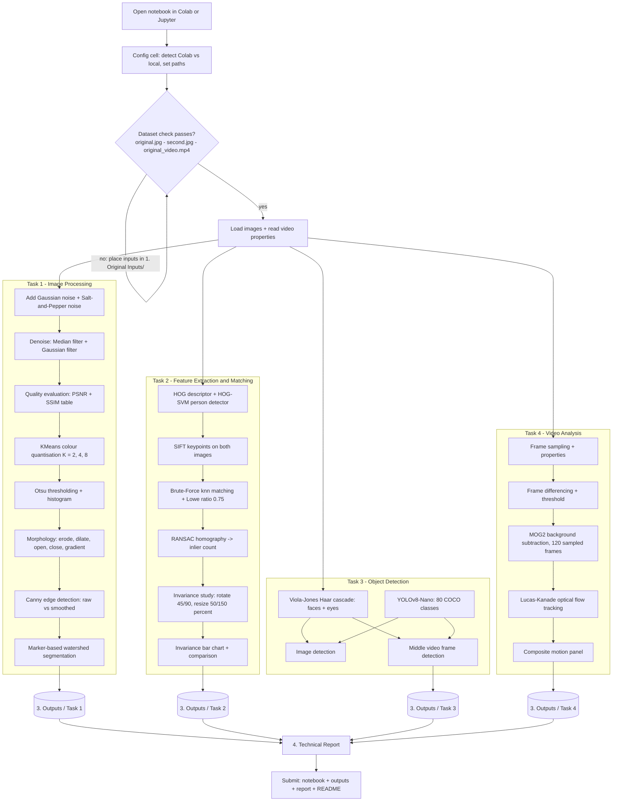

# CCA 3 — Explanation Video Plan + Pipeline Diagrams

This folder originally holds the explanation video. Until it is recorded, the diagrams
below serve as the **storyboard / recording script** for that video, and the main
pipeline diagram is also embedded in `README.md`.

Suggested video: **3–5 minutes**, screen recording of the notebook + results, narrated
Node-by-node following Storyboard diagram at the bottom.

---

## 1. Main pipeline diagram (also embedded in README.md)

---

## 2. Video storyboard (record in this order)

```mermaid
flowchart LR
    V0["0:00 - Intro: project + 4 tasks + repo layout"] --> V1["0:30 - Notebook config: Colab vs local paths"]
    V1 --> V2["1:00 - Task 1: show noise, denoised grid, PSNR/SSIM table"]
    V2 --> V3["2:00 - Task 2: show HOG visual, SIFT matches, invariance chart"]
    V3 --> V4["3:00 - Task 3: show face boxes + YOLO detections"]
    V4 --> V5["4:00 - Task 4: show diff, MOG2 masks, LK tracks"]
    V5 --> V6["4:45 - Outputs folder + technical report tour"]
    V6 --> V7["5:00 - Conclusion: what was learned"]
```

---

## 3. Recording checklist

- [ ] Screen + microphone recording (OBS / Zoom / Xbox Game Bar)
- [ ] Notebook executed top-to-bottom before recording (no pip-wait pauses)
- [ ] Keep the PSNR/SSIM table, invariance bar chart and one watershed figure in frame — these carry the "quantified results" discussion
- [ ] Mention where each figure in `3. Outputs/` comes from while scrolling
- [ ] Export as MP4/MOV into this folder and rename to include your ID, e.g. `Explanation Video 1039.mp4`
