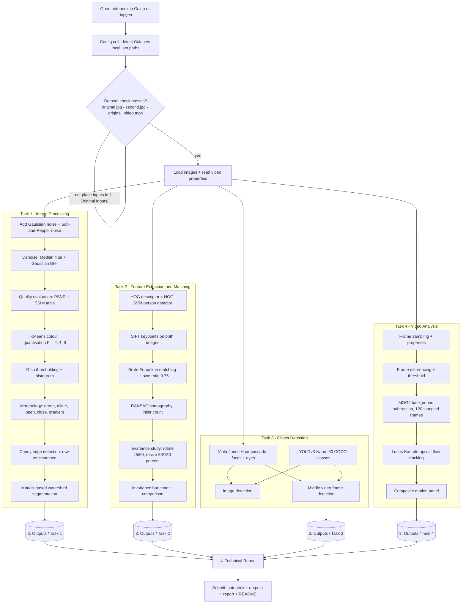

# Computer Vision CCA 3: Practical Coding Assignment — Units 3, 4 and 5

## 1. Project Overview

This repository contains the implementation of the Computer Vision CCA 3 Practical Coding Assignment covering Units 3, 4 and 5.

The project demonstrates various computer vision techniques using Python, OpenCV and other image processing libraries. It includes image processing, feature extraction, object detection and video analysis.

The practical work is implemented using Google Colab and Python Jupyter Notebook.

## 2. Objectives

- Understand and implement fundamental image processing techniques.
- Apply noise reduction and image enhancement methods.
- Extract and match image features using HOG and SIFT.
- Perform face and object detection using computer vision algorithms.
- Analyse video using frame differencing and background subtraction.
- Track object movement using Lucas–Kanade optical flow.

## 3. Technologies and Libraries Used

- Python
- Google Colab
- Jupyter Notebook
- NumPy
- Matplotlib
- OpenCV
- Scikit-image
- Scikit-learn
- Ultralytics YOLOv8

## 4. Project Tasks

### Task 1: Image Processing

Implementation of image processing techniques, including:

- Gaussian noise and Salt-and-Pepper noise.
- Image denoising using Median and Gaussian filters.
- Image quality evaluation using PSNR and SSIM.
- Otsu thresholding.
- Morphological operations.
- Canny edge detection.
- Watershed segmentation.

### Task 2: Feature Extraction and Matching

Implementation of image feature extraction and matching techniques:

- Histogram of Oriented Gradients (HOG).
- Scale-Invariant Feature Transform (SIFT).
- Brute Force feature matching.
- Feature matching after image rotation and resizing.
- Comparison of feature matching results.

### Task 3: Object Detection

Implementation of face and object detection techniques:

- Face detection using the Viola–Jones algorithm.
- Object detection using YOLOv8 Nano.
- Detection on an image and a selected video frame.

### Task 4: Video Analysis

Implementation of video processing and motion analysis techniques:

- Video frame extraction.
- Frame differencing.
- Background subtraction using MOG2.
- Object tracking using Lucas–Kanade optical flow.
- Motion detection and visualisation.

### Pipeline overview



## 5. Repository Structure

```
Computer-Vision-CCA3/
│
├── 1. Original Inputs/
│   ├── original.jpg
│   ├── second.jpg
│   └── original_video.mp4
│
├── 2. Source Code/
│   └── Computer_Vision_CCA3_1272251039.ipynb
│
├── 3. Outputs/
│   ├── Task 1/
│   ├── Task 2/
│   ├── Task 3/
│   └── Task 4/
│
├── 4. Technical Report/
│   └── Computer Vision CCA 3 Technical Report
│
├── 5. Explanation Video/
│
├── README.md
├── requirements.txt
└── .gitignore
```

## 6. Requirements

The following Python packages are required to execute the project:

- numpy (pinned `<3` to match Colab)
- matplotlib
- opencv-python (pinned `<5` to match Colab)
- scikit-image
- scikit-learn
- ultralytics
- jupyter

Install the required packages using:

```bash
pip install -r requirements.txt
```

## 7. Dataset Information

The project uses image and video input files for performing the computer vision tasks.

Required input files:

- `original.jpg`
- `second.jpg`
- `original_video.mp4`

### Dataset Organisation

1. Obtain the original input images and video provided for the assignment.
2. Place the files inside the `1. Original Inputs/` folder.
3. Maintain the filenames expected by the notebook.
4. Ensure that the notebook uses the correct file paths before executing the cells.

If the dataset is not included in the repository, obtain it separately from the assignment-provided source.

> **Note on this repository's inputs:** the three files in `1. Original Inputs/` are generated stand-ins used for development/testing — `original.jpg` is a composite (street scene + portrait assembled from Wikimedia Commons photographs), `second.jpg` is a transformed variant of it, and `original_video.mp4` is a synthetic moving-object scene (7 s, 30 fps, 960 x 540). Replace them with the files provided by the college for the official submission; the notebook runs unchanged either way.

## 8. Execution Instructions

The project is implemented in Google Colab. Follow these steps to execute the notebook:

1. Open Google Colab: <https://colab.research.google.com/>
2. Upload or open the notebook: `2. Source Code/Computer_Vision_CCA3_1272251039.ipynb`
3. Install the required Python libraries by running:

   ```
   !pip install -q numpy matplotlib "opencv-python<5" scikit-image scikit-learn ultralytics
   ```

4. Upload the required input images and video, or connect Google Drive containing the dataset.
5. Verify that the dataset file paths in the notebook are correct.
6. Execute all notebook cells sequentially using **Runtime → Run all**.
7. View the generated outputs and results for all four tasks.

> **Local execution:** the notebook auto-detects its environment. Set `ENVIRONMENT = "local"` or `"colab"` in the configuration cell; local execution uses relative paths into `1. Original Inputs/` and `3. Outputs/`.

## 9. Results and Outputs

The results generated during the execution of the notebook are organised in the `3. Outputs/` folder.

The output folders contain selected visual results from:

- **Task 1:** Image processing and segmentation.
- **Task 2:** Feature extraction and matching.
- **Task 3:** Face and object detection.
- **Task 4:** Video analysis and object tracking.

Refer to the output images and the technical report for detailed observations and results.

## 10. Technical Report

The detailed technical report is available in `4. Technical Report/`. It describes the objectives, methodology, implementation, results and conclusions of the practical assignment.

## 11. Conclusion

This Computer Vision practical assignment provides hands-on experience with image processing, feature extraction, object detection and video analysis.

By implementing these techniques using Python and OpenCV, the project demonstrates how computer vision methods can be applied to analyse images, identify objects, extract meaningful features and track motion in video sequences.
